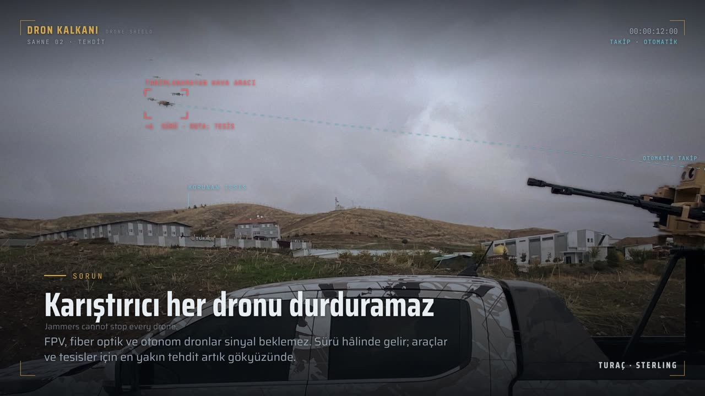
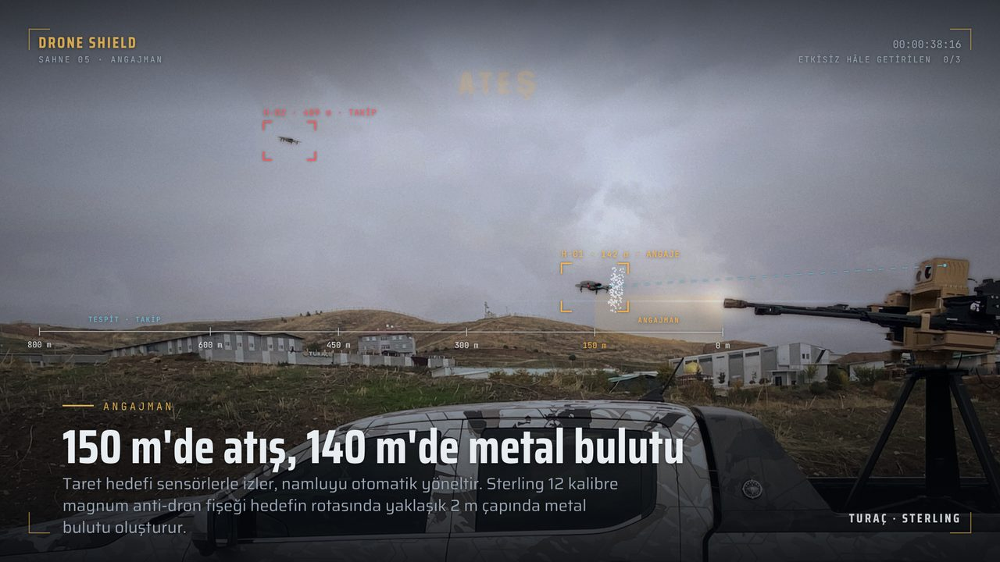
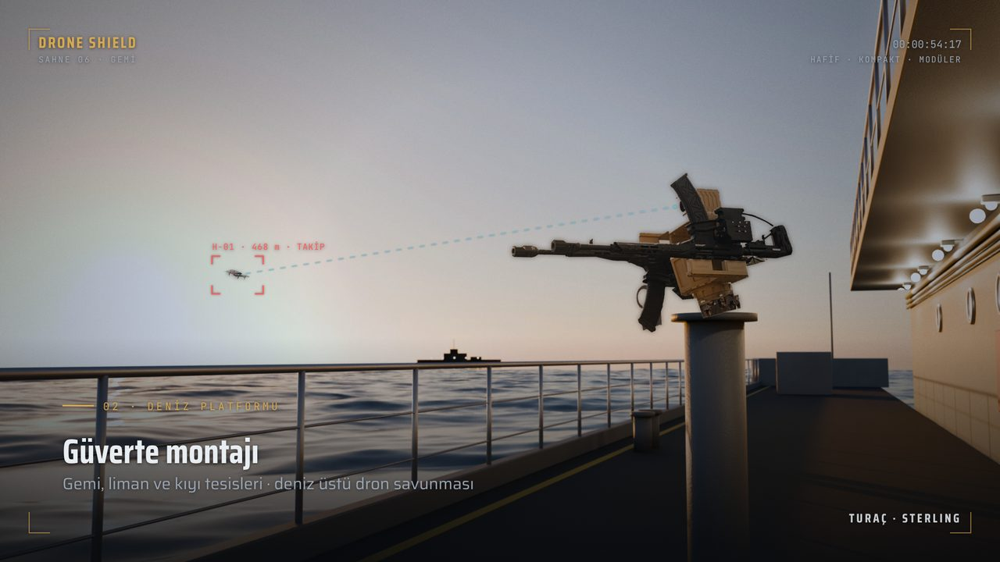
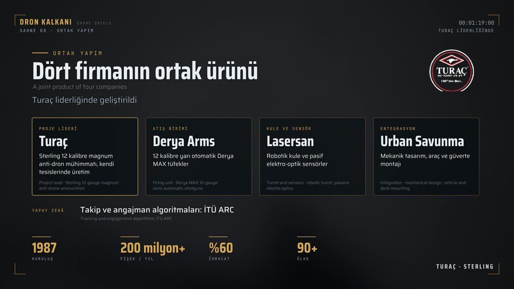
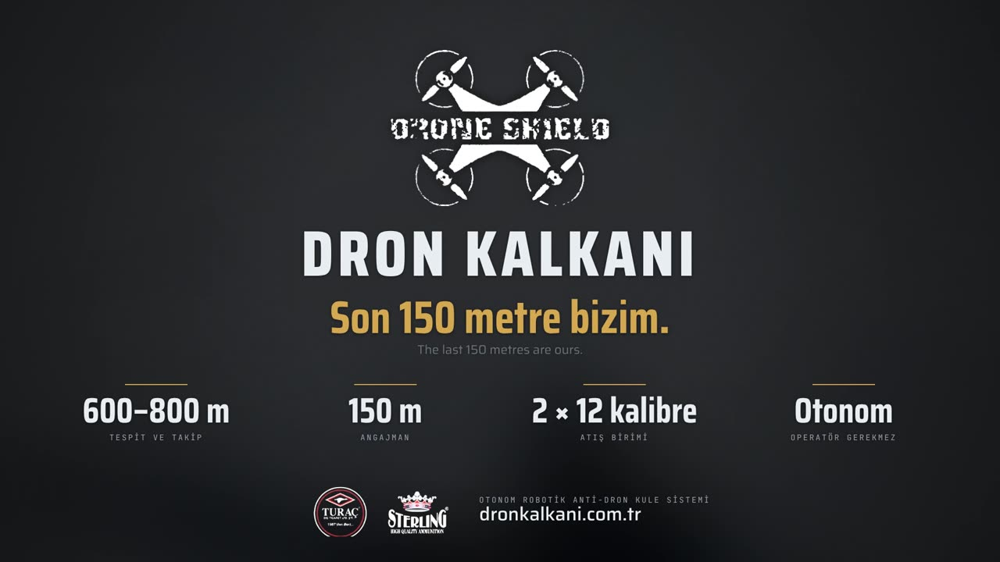

# Dron Kalkanı · Drone Shield — Tanıtım Filmi Senaryosu

**Sürüm:** v10, ortak kurgu ve gerçek kule modeliyle 3B çekim · **Süre:** 88 saniye · **Format:** 1920×1080, 30 fps · **Dil:** Türkçe büyük, İngilizce karşılığı küçük ve silik
**Görsel yaklaşım:** Gerçek saha fotoğrafları (pikap kasasındaki sistem, kule yakın planı, sensör başlığı) üzerine animasyonlu gösterge, dron, atış ve yazı katmanları. Kule fotoğraflardan alfa kanallı olarak ayrıldı ve dönüş ekseni etrafında döndürülerek dronları izliyor. Sahne 04'te gerçek kule CAD modelinden render edilmiş 3B yörünge çekimi var. Gemi güvertesi ve rafineri 3B render; dronlar 3B modelden. Sinematik renk düzeni, hafif film greni, el kamerası hareketi.
**Ses:** Sentezlenmiş müzik yatağı ve efektler (`render/ses/ses.py`). Seslendirme kaydı yoktur; aşağıdaki metin stüdyo kaydı içindir.

> Bu sürüm iki ayrı çalışmayı birleştirir: bu depodaki fotoğraflı film (v1–v8) ile "Dron kalkanı simülasyonu" konuşmasında yapılan Tanıtım Filmi, Mühendislik Filmi ve 3B Vitrin. Ürün bilgileri ve kurallar o konuşmanın devir özetinden alındı (`surumler/ilk-calismalar/PROJE-OZETI-simulasyon-sohbeti.md`); özeti `PROJE-OZETI.md` içinde.

## Uyulan kurallar

1. Tespit ve takip her yerde **600–800 m**, angajman **150 m**.
2. Başka firma logosu, bayrağı ve araç plakası kadraja girmez. Fotoğraflardaki araç amblemi, model yazısı, Kaiser logosu ve plaka silindi (`render/rotus/rotus.py`). Sterling ve Dron Kalkanı işaretleri kalır.
3. **Derya MAX** adı yalnızca ortak yapım sahnesinde geçer; ara sahnelerde "çift 12 kalibre / atış birimi" denir.
4. Sensörler **pasif elektro-optik ve akustik**tir; "radar" sensör olarak anılmaz.
5. Türkçe metin büyük, İngilizce karşılığı küçük ve silik.
6. Ürün adı "Dron Kalkanı", ürün tanımı "otonom robotik anti-dron kule".

---

## Sahne listesi

| # | Zaman | Sahne | Görüntü | Ekran yazısı |
|---|------:|-------|---------|--------------|
| 01 | 00:00–00:07 | Açılış | Pikap arka çapraz, kule (yavaş yaklaşma) | DRON KALKANI · "Karıştırıcının bittiği yerde başlar." |
| 02 | 00:07–00:15 | Sorun | Pikap yan görünüş, tesis ve gökyüzü; kule sürüyü izler | SORUN · "Karıştırıcı her dronu durduramaz" |
| 03 | 00:15–00:24 | Tespit ve takip | Sensör başlığı | "Pasif sensörler, gömülü yapay zekâ" |
| 04 | 00:24–00:34 | Robotik kule | Kule yakın planı (fotoğraf), ardından gerçek CAD modeliyle 3B yörünge çekimi | Beş parça açıklaması · "Otonom çalışır, operatör gerekmez" |
| 05 | 00:34–00:48 | Angajman | Pikap yan görünüş + izleyen kule | "Son 150 metrede angajman" |
| 06 | 00:48–01:02 | Araçta · gemide · kulede | Pikap fotoğrafı · 3B güverte · 3B rafineri | 01 ARAÇTA · 02 GEMİDE · 03 KULEDE |
| 07 | 01:02–01:14 | Katmanlı savunma | Ölçeksiz şema: gökyüzü ağ katmanları ve beş kubbe; ardından fotoğrafta en iç kubbe | "Karıştırıcının bittiği yerde başlar" · "Karıştırıcıyı aşan dron burada durur" |
| 08 | 01:14–01:21 | Ortak yapım | Koyu zemin, dört kart | "Dört firmanın ortak ürünü" |
| 09 | 01:21–01:28 | Kapanış | Koyu zemin | DRON KALKANI · "Son 150 metre bizim." · dronkalkani.com.tr |

---

## Sahne sahne senaryo

### 01 · Açılış (00:00–00:07)
**Görüntü.** Karartıdan açılır. Pikabın arka çapraz fotoğrafı; kamera yavaşça kuleye yaklaşır. Sol üstte ürün logosu, altında "DRON KALKANI" soldan sağa açılır, ardından slogan ve özellik satırı. Sol altta Turaç ve Sterling logoları.
**Ekran yazısı.** DRON KALKANI — Karıştırıcının bittiği yerde başlar. (It starts where jamming ends.) — OTONOM ROBOTİK ANTİ-DRON KULE · ÇİFT 12 KALİBRE · GÖMÜLÜ YAPAY ZEKÂ
**Seslendirme.** "Dronlar artık her yerde. Dron Kalkanı: karıştırıcının bittiği yerde başlar."

### 02 · Sorun (00:07–00:15)
**Görüntü.** Yan görünüş; tesis ve tepeler altta, gökyüzü üstte. Altı dron sürü hâlinde tesise yaklaşır. Öncü dron kırmızı kutuyla işaretlenir; sağ kenardaki kule ona doğru döner, sensörden drona kesikli "OTOMATİK TAKİP" çizgisi uzanır.
**Ekran yazısı.** SORUN — Karıştırıcı her dronu durduramaz (Jammers cannot stop every drone.) — "FPV, fiber optik ve otonom dronlar sinyal beklemez. Sürü hâlinde gelir; araçlar ve tesisler için en yakın tehdit artık gökyüzünde."
**Seslendirme.** "Karıştırıcı her dronu durduramaz. Fiber optik ve otonom dronlar sinyal beklemez."

### 03 · Tespit ve takip (00:15–00:24)
**Görüntü.** Sensör başlığı, yavaş yaklaşma. Solda 360° pasif takip ekranı, sağda elektro-optik termal görüntü penceresi: hedef durumu TESPİT → TAKİP → KİLİT. Menzil 800 m'den 600 m'ye düşer. Sensör başlığından akustik halkalar yayılır. "OPTİK · TERMAL · AKUSTİK → GÖMÜLÜ YAPAY ZEKÂ" şeridi.
**Ekran yazısı.** TESPİT VE TAKİP — Pasif sensörler, gömülü yapay zekâ (Passive sensors, embedded AI) — "Elektro-optik ve akustik sensörler yayın yapmaz, sistem yerini belli etmez. Hedef 600–800 m mesafede tespit edilir ve kesintisiz izlenir."
**Seslendirme.** "Pasif elektro-optik ve akustik sensörler hedefi altı yüz ile sekiz yüz metrede tespit eder. Görüntüyü kule üzerindeki yapay zekâ işler."

### 04 · Robotik kule (00:24–00:34)
**Görüntü.** Koyu zemin üzerinde kulenin yakın plan paneli. Soldan sırayla beş açıklama, lider çizgileriyle parçalara bağlanır; başlık gelirken açıklamalar çekilir. 0:28.9'da aynı panelde fotoğraf, gerçek kule CAD modelinin 3B çekimine geçer: kamera 5 saniyede kulenin arka çaprazından ön çaprazına 95 derece döner, namlular hep solda kalır. Koyu stüdyo, sıcak ana ışık ve soğuk kenar ışıkları; sol üstte "3B CAD MODELİ" etiketi.
1. MÜHİMMAT — Sterling 12 kal. magnum anti-dron fişek
2. SENSÖR — Pasif elektro-optik sensör kutusu
3. ATIŞ BİRİMİ — Çift 12 kalibre tüfek · biri ters monte
4. ROBOTİK KULE — İki eksende otomatik hedef takibi
5. PLATFORM — Araç kasası, gemi güvertesi, sabit kule
**Ekran yazısı (0:29.6).** OTONOM ROBOTİK KULE — Otonom çalışır, operatör gerekmez (Autonomous: no operator needed to engage) — "Gömülü yapay zekâ hedefi kule üzerinde işler, atış anını ve ön tutuşu hesaplar. İstenirse uzaktan kumanda edilir."
**Seslendirme.** "Çift on iki kalibre, Sterling magnum anti-dron mühimmatı. Angajman için operatör gerekmez."

### 05 · Angajman (00:34–00:48)
**Görüntü.** Yan görünüş. Kule her hedefi izler, hedef değişince yarım saniyede yenisine döner; atışta geri tepme ve kamera sarsıntısı. Menzil çubuğu: 800 · 600 · 450 · 300 · 150 · 0 m; 0–150 m "ANGAJMAN" bölgesi sarı. Üç dron sırayla gelir; her biri 150 m'ye girince atış, metal bulutu, dron düşer. Sayaç 0/3 → 3/3.
- H-01: giriş 0:34.3 · atış 0:38.3 · vuruş 0:38.6
- H-02: giriş 0:36.3 · atış 0:41.0 · vuruş 0:41.3
- H-03: giriş 0:39.0 · atış 0:44.0 · vuruş 0:44.3
**Ekran yazısı.** ANGAJMAN — Son 150 metrede angajman (Engagement inside the last 150 metres) — "Kule hedefi izler, namluyu otomatik yöneltir. Sterling 12 kalibre magnum anti-dron fişeği hedefin rotasında metal bulutu oluşturur."
**Seslendirme.** "Altı yüz metrede görür, yüz elli metrede durdurur. Sürü gelirse sıradakine döner."

### 06 · Araçta · gemide · kulede (00:48–01:02)
Üç kısa bölüm, her biri yaklaşık 4,7 saniye. Her birinde tek dron yaklaşır, kule izler, 150 m'de ateş eder, hedef düşer.
1. **ARAÇTA (0:48–0:52.7).** Pikap fotoğrafı. "Pikap kasasında, tripod üstünde — Konvoy ve araç koruması".
2. **GEMİDE (0:52.7–0:57.3).** 3B güverte, gün batımı. "Kargo gemisi ve tanker güvertesinde — Güverte montajı · seyirde ve limanda dron savunması".
3. **KULEDE (0:57.3–1:02).** 3B rafineri, alacakaranlık. "Rafinerilerde ve kritik tesislerde — Sabit kurulum · enerji altyapısı ve depolama sahaları".
**Seslendirme.** "Araçta, gemide, kulede. Üç platform, tek sistem."

### 07 · Katmanlı savunma (01:02–01:14)
**07a (1:02–1:09), ölçeksiz şema.** Sağ üstte gökyüzündeki ağ katmanları: komuta kontrol, radar ağı, muhabere ağı, veri bağı. Yerde dıştan içe beş kubbe sırayla yükselir; her kubbenin bandında solda tehdit, sağda çözüm yazar. Veri bağından dıştaki üç kubbeye çizgiler iner. İki dron bütün katmanları geçip en iç kubbeye yaklaşır.

| Katman | Çözüm (sağ) | Tehdit (sol) |
|---|---|---|
| 5 | Uzun menzil hava savunma | Uçak, seyir füzesi |
| 4 | Orta menzil hava savunma | Uçak, helikopter, büyük İHA |
| 3 | Kısa menzil hava savunma | Alçak uçan hedefler, İHA |
| 2 | Elektronik harp · karıştırıcı | Telsizle yönetilen dronlar |
| 1 | **DRON KALKANI** · 600–800 m tespit · 150 m angajman | FPV, fiber optik ve otonom dronlar |

**Ekran yazısı.** KATMANLI SAVUNMA — Karıştırıcının bittiği yerde başlar (Where jamming ends, the last layer begins)
**07b (1:09–1:14), fotoğraf.** Şema, en iç kubbeye yaklaşarak gerçek fotoğrafa geçer: kulenin çevresinde 150 m kubbesi ve tek hedefli angajman.
**Ekran yazısı.** 1. KATMAN · DRON KALKANI — Karıştırıcıyı aşan dron burada durur (The drone that slips past jamming stops here) — "Diğer hava savunma katmanlarının yerine değil, yanına: FPV, fiber optik ve otonom dronlara karşı son 150 metre."
**Seslendirme.** "Hava savunması katman katmandır. Karıştırıcıyı aşan dron için son katman: Dron Kalkanı."

### 08 · Ortak yapım (01:14–01:21)
**Görüntü.** Koyu zemin. Başlık, sağ üstte Turaç logosu, ardından dört kart sırayla gelir; altında yapay zekâ satırı ve Turaç'ın üretim rakamları. Ortak firmalar yalnızca yazıyla anılır.

| Rol | Firma | Açıklama |
|---|---|---|
| Proje lideri | Turaç | Sterling 12 kalibre magnum anti-dron mühimmatı, kendi tesislerinde üretim |
| Atış birimi | Derya Arms | 12 kalibre yarı otomatik Derya MAX tüfekler |
| Kule ve sensör | Lasersan | Robotik kule ve pasif elektro-optik sensörler |
| Entegrasyon | Urban Savunma | Mekanik tasarım, araç ve güverte montajı |
| Yapay zekâ | İTÜ ARC | Takip ve angajman algoritmaları |

Rakamlar: 1987 kuruluş · yılda 200 milyon+ fişek · %60 ihracat · 90+ ülke.
**Ekran yazısı.** ORTAK YAPIM — Dört firmanın ortak ürünü (A joint product of four companies) — Turaç liderliğinde geliştirildi
**Seslendirme.** "Turaç liderliğinde dört firmanın ortak ürünü."

### 09 · Kapanış (01:21–01:28)
**Görüntü.** Koyu zemin. Logo, DRON KALKANI, slogan. Dört değer sırayla: 600–800 m (tespit ve takip) · 150 m (angajman) · 2 × 12 kalibre (atış birimi) · Otonom (operatör gerekmez). Altta Turaç ve Sterling logoları, "OTONOM ROBOTİK ANTİ-DRON KULE SİSTEMİ", dronkalkani.com.tr. Karartı.
**Ekran yazısı.** Son 150 metre bizim. (The last 150 metres are ours.)
**Seslendirme.** "Dron Kalkanı. Son yüz elli metre bizim."

---

## Üretim notları

- **v9: ortak kurgu.** İki konuşmanın çalışması tek filmde birleşti. Önceki konuşmadan alınanlar: ürün bilgileri ve kurallar, "Karıştırıcının bittiği yerde başlar" ve "Son 150 metre bizim" sloganları, beş katmanlı savunma şeması (tehditler solda, çözümler sağda), ortak yapım sahnesi, Turaç'ın üretim rakamları, kapanış değerleri ve web adresi. Bu depodan kalanlar: fotoğraflı sahneler, dronu izleyen kule, angajman efektleri, 3B gemi ve rafineri, gökyüzündeki ağ katmanları, ses bandı. Film 80 saniyeden 88 saniyeye çıktı; ses bandı yeni zamanlamaya göre yeniden üretildi.
- **v9: kurala uydurulan yerler.** Fotoğraflardan araç amblemi, model yazısı, Kaiser logosu ve plaka karakterleri silindi (`render/rotus/rotus.py`). "Radar", "30×", "360°", "yaklaşık 2 m" ve "140 m" ifadeleri kaldırıldı: bunlar ürün özetinde yok. Ekrandaki ürün adı "DRON KALKANI" oldu; İngilizce "DRONE SHIELD" küçük ve silik yazılıyor. "Taret" yerine ürün özetindeki "robotik kule" kullanıldı.
- **v10: gerçek kule modeliyle 3B çekim.** Sahne 04'ün ikinci yarısı artık 3B: `render/3d/kule3b.py`, kullanıcının SolidWorks montajından gelen kule modelini (`render/3d/modeller/taret.glb`, gövde ve tüfekler) Blender'da koyu bir stüdyoya yerleştirir ve kamerayı çevresinde döndürür. 153 kare, 1160×1080, `animasyon/assets/kule3b/` altında; film motoru bunları sahnenin sağ paneline yerleştirir ve filmin renk düzeni ile grenini üstüne uygular. Gövde kum rengi mat boya, tüfekler siyah. Montajda bulunmayan iki parça temsilîdir: elektro-optik sensör kutusu saha fotoğraflarına bakılarak yaklaşık 19 × 19 × 16 cm ölçüyle, önde iki mercek ve yanlarda havalandırma yarıklarıyla modellendi; kaide ve tripod sade siyah parçalardır. CAD modelindeki şarjör ve gövde kabartmaları ("MAX", modelde aynalı) çekimde seçilebiliyor.
- **v9: henüz alınmayanlar.** Mühendislik Filmi'ndeki teknik çizim katmanları ve 3B Vitrin'in pikap, tanker ve rafineri turu kaynak olarak depoda duruyor (`surumler/ilk-calismalar/kaynak/`), filme girmedi. Yapay zekâ videosu için hazırlanan başlangıç kareleri (`docs/ai-video/kareler/`) eski, rötuşsuz fotoğraflardan üretilmişti; yeniden üretilmeleri gerekir.

- **v8: sade katman sahnesi.** Sahne 07 iki parçaya ayrıldı. İlk beş saniye sade bir kavram çizimi: gökyüzünde dört ağ katmanı (komuta kontrol, radar ağı, muhabere ağı, veri bağı), veri bağından kubbelere inen çizgiler, yerde iç içe üç savunma kubbesi ve en içte Drone Shield. Düzen, kullanıcının gönderdiği Steeldome görselinden esinlenir; görselin kendisi, ASELSAN ve ürün adları, logolar ve bayraklar kullanılmadı, katman adları genel işlev adlarıdır. Son beş saniyede aynı fikir gerçek fotoğrafta gösterilir: en iç kubbe ve tek hedefli angajman.
- **Taret 3B modeli.** Kullanıcının 6 Kasım tarihli Vitrin sayfasındaki glTF model (`body` ve `gun` ağları, toplam 233 bin köşe) `render/3d/modeller/taret.glb` olarak depoya alındı. Henüz filmde kullanılmıyor; tamamı 3B sahneler için hazır. Yatay ve dikey dönüş için ağın parçalara ayrılması gerekiyor.

- **v7: 3B dron.** Filmdeki dronlar artık kullanıcının 3B baskı projesinden gelen dron ağından (`render/3d/modeller/dron.npz`, 128 bin köşe) render ediliyor: `render/3d/dron3b.py` saydam zeminli iki görünüm üretir, film motoru bunları yatış, hareket bulanıklığı ve uzaklık pusuyla kullanır. Model büyük olasılıkla bir model paylaşım sitesinden indirilmiş bir tasarımdır ve ticari bir dronu andırır; tanıtım filminde kullanım için lisansı ve marka benzerliği yayın öncesi kontrol edilmeli. `render/3d/ucmf.py`, Bambu Studio 3MF projelerinin parça dosyalarını okur; taret ve pikap modelleri geldiğinde aynı yoldan eklenecek.

- **v6: 3B ortamlar ve ses.** Gemi güvertesi ve rafineri kulesi artık çizim değil, Blender (Cycles) ile fiziksel ışıkla render edilmiş plakalar: gün batımı göğü, okyanus, perspektifli güverte ve korkuluk; alacakaranlıkta damıtma kolonları, tanklar, boru rafları ve sodyum lambaları. Her sahne arka ve ön katman olarak render edilir; film motoru denizi kıpırdatır, gemi yalpasını, flare alevini, buharı ve lamba parlamasını ekler. Taret yine gerçek fotoğraf kesmesidir. Filme sentezlenmiş bir ses bandı eklendi: müzik yatağı, dron vızıltısı, servo, atış ve vuruş sesleri, radar tonları, sahne geçişleri, ortam sesi. Ses bandı kulakla dinlenerek değil, seviye ve spektrum ölçümüyle doğrulandı; yayın öncesi dinlenmeli.

- **v5 düzeltmeleri.** Hedef kutuları, etiketler, menzil çubuğu ve katman lejantı artık renk düzeninden sonra çiziliyor (net ve doygun). Akşam sahnelerinde taret boyaması düzeltildi (namlu siyah kalıyor). Taret kesmelerindeki arka plan artıkları ve anahtarlama delikleri temizlendi. Rafineri ve gemi göğü, içinde taret parçası bulunmayan temiz gökyüzü kırpımından alınıyor. Gemi üst yapısı köprü camları, su geçirmez kapı, merdiven ve can simidiyle yeniden çizildi. Sahne 07'de katman adları sol üstte lejant olarak veriliyor.
- **Yapay zekâ videosu.** `docs/ai-video/` altında çekim listesi, temiz başlangıç kareleri ve ürün referansları var. Film motoru `?clean=1` ile HUD'suz, yazısız kare üretir.

- **Logolar.** DRONE SHIELD logosu Boran VIII afişinden ayıklandı; Turaç ve Sterling logoları aynı afişin alt bandından kırpıldı. Final yayın için vektör (SVG/EPS) logolarla değiştirilmeli: `animasyon/assets/logo-*.png`.
- **Fotoğraflar.** Kullanılan plakalar `animasyon/assets/` altında. `*-clean.jpg` dosyaları taretin silinip gökyüzüyle doldurulduğu temiz plakalar, `taret-*-cut.png` dosyaları alfa kanallı taret kesmeleri (dönüş ekseni ve namlu ucu koordinatları `index.html` içindeki SPR tablosunda). Araç amblemi, Kaiser logosu ve plaka v9'da silindi. Üst/ön görünüş renderları ve saha testi fotoğrafı bu sürümde kullanılmıyor (`docs/kaynak-gorseller/`).
- **Dronlar.** `animasyon/assets/dron-3b-a.png` ve `dron-3b-b.png`, 3B dron modelinden render edilir (640 px genişlik). v6 ve öncesinde afişteki dron fotoğraflarından ayıklanmış küçük kesmeler kullanılıyordu.
- **Gemi ve rafineri.** Bu platformların fotoğrafı olmadığı için ortamlar gerçek gökyüzü fotoğrafı üzerine çizildi; gerçek güverte/rafineri fotoğrafı sağlanırsa aynı taret kesmesi onların üzerine bindirilebilir.
- **Referans videolar.** Paylaşılan iki YouTube bağlantısı bu ortamdan açılamadı; sahneler yazılı isteklere göre kuruldu. Videolardaki belirli bir sahne/anlatım isteniyorsa kısa bir tarif yeterli.
- **Afiş ve maket fotoğrafı** referans olarak `docs/kaynak-gorseller/` altında (filmde kullanılmıyor; afişteki etkinlik tarihi geçmiş).
- **Steeldome görseli.** ASELSAN'ın markalı görseli olduğu için filme konmadı; katmanlı savunma fikri 07. sahnede özgün bir diyagramla anlatıldı.
- **Ortak firmalar.** v9'dan itibaren 08. sahnede yazıyla anılıyor; logoları kullanılmıyor.
- **Ses.** Seslendirme için yukarıdaki metin toplam ~70 kelime/sahne hızında okunduğunda zamanlamaya oturur. Müzik önerisi: 90–100 BPM, perküsif, sinematik.

---

## Storyboard kareleri

| 01 Açılış | 02 Sorun |
|---|---|
|  |  |

| 03 Tespit ve takip | 04 Robotik kule |
|---|---|
|  |  |

| 05 Angajman | 06 Araçta · gemide · kulede |
|---|---|
|  |  |

| 07 Katmanlı savunma | 08 Ortak yapım |
|---|---|
|  |  |

| 09 Kapanış | |
|---|---|
|  | |
