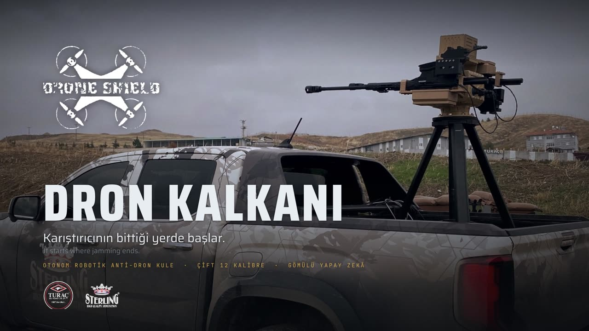
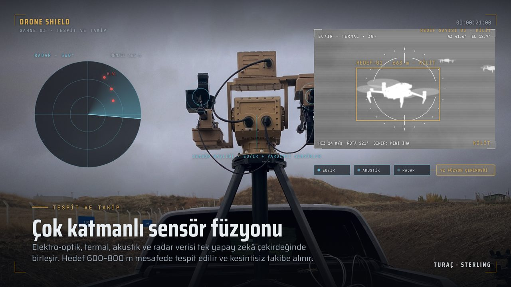
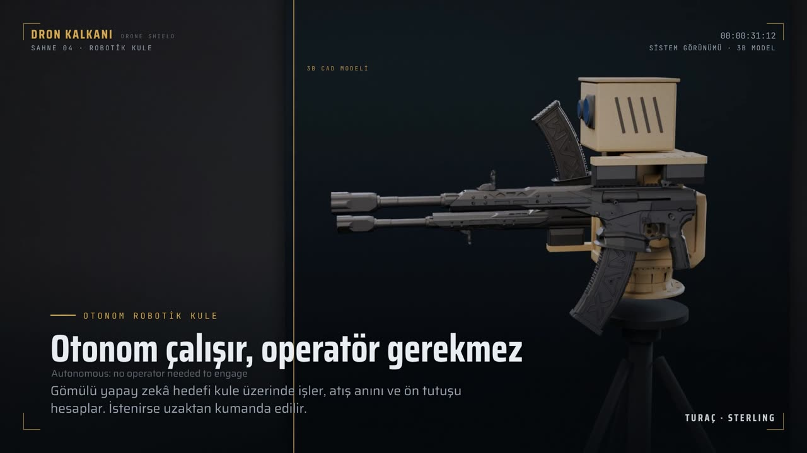
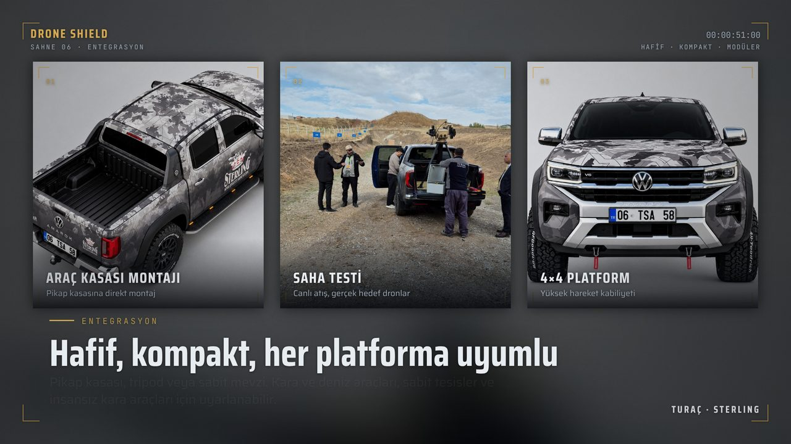
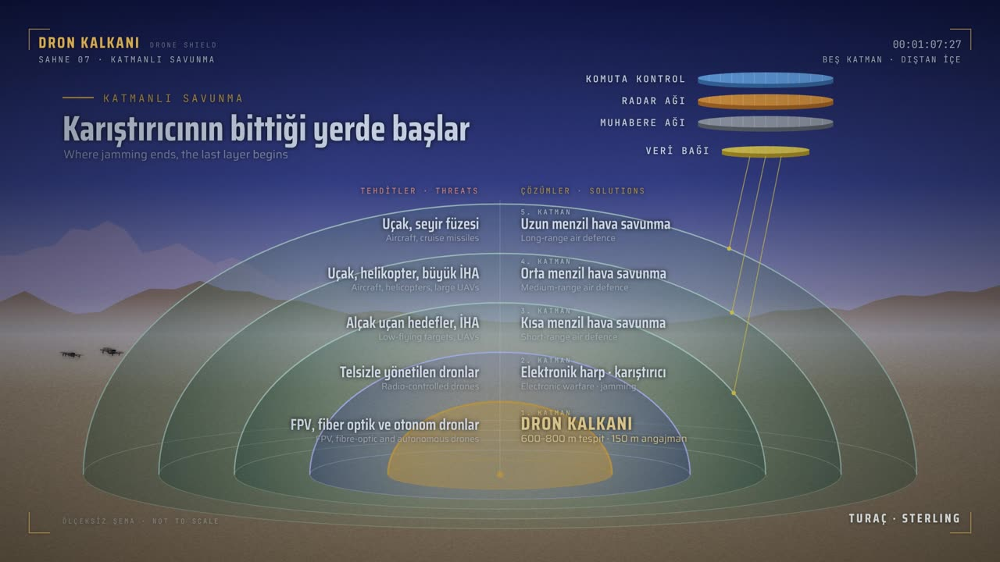
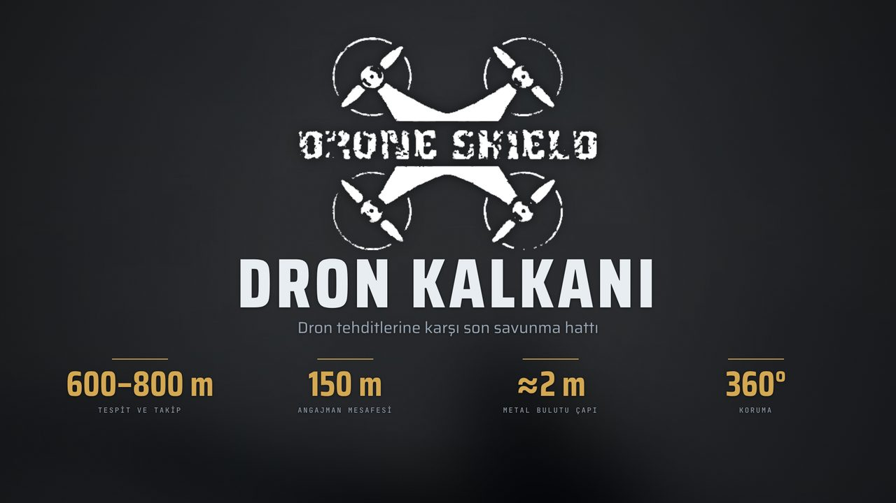

# Drone Shield · Dron Kalkanı — Tanıtım Filmi Senaryosu

**Süre:** 80 saniye · **Format:** 1920×1080, 30 fps · **Dil:** Türkçe
**Görsel yaklaşım:** Gerçek saha fotoğrafları (Amarok üzerindeki sistem, taret yakın planı, sensör başlığı) üzerine animasyonlu HUD, dron, atış ve yazı katmanları. Taret fotoğraflardan alfa kanallı olarak ayrıldı ve pan-tilt ekseni etrafında döndürülerek dronları gerçekten takip ediyor (namlu hedefin yükseliş açısına göre yönelir, atışta geri tepme ve kamera sarsıntısı). Gemi ve rafineri sahneleri, fotoğrafı olmayan ortamlar için çizilmiş akşam/gece ortamlarına gerçek taret kesmesinin bindirilmesiyle üretildi. Sinematik renk düzeni (soğuk gölgeler, sıcak vurgular), hafif film greni.
**Ses:** Film sessiz döngü olarak da çalışır (fuar ekranı). Aşağıdaki seslendirme metni ve müzik notları ses kurgusu içindir.

> Menzil ve mühimmat rakamları (600–800 m tespit, 150 m angajman, ~140 m'de ~2 m metal bulutu) basına yansıyan şirket açıklamalarından alınmıştır. Yayın öncesi Turaç tarafından doğrulanmalıdır.

---

## Sahne listesi

| # | Zaman | Sahne | Plaka (fotoğraf) | Ekran yazısı |
|---|------:|-------|------------------|--------------|
| 01 | 00:00–00:07 | Açılış | Amarok arka ¾, taret (yavaş yaklaşma) | DRONE SHIELD logosu · DRON KALKANI · "Dron tehditlerine karşı son savunma hattı" |
| 02 | 00:07–00:15 | Tehdit | Amarok yan görünüş, tesis ve gökyüzü; sağdaki taret sürüyü izler | TEHDİT · "FPV ve mini İHA sürüleri" |
| 03 | 00:15–00:24 | Tespit ve takip | Sensör başlığı (arka görünüş) | TESPİT VE TAKİP · "Çok katmanlı sensör füzyonu" |
| 04 | 00:24–00:34 | Robotik taret | Taret yakın planı (kamuflaj ağı) | Parça açıklamaları · "Yapay zekâ kilitler, taret takip eder" |
| 05 | 00:34–00:48 | Angajman | Amarok yan görünüş (temiz plaka) + takip eden taret kesmesi | ANGAJMAN · "150 m'de atış, 140 m'de metal bulutu" |
| 06 | 00:48–01:02 | Araç · gemi · rafineri kulesi | Amarok arka ¾ (temiz plaka) · çizilmiş güverte · çizilmiş rafineri; her birinde takip eden taret | 01 ARAÇ ÜSTÜ · 02 DENİZ PLATFORMU · 03 RAFİNERİ |
| 07 | 01:02–01:12 | Hava katmanları | Amarok yan görünüş (geniş), gökyüzünde kubbe katmanları + takip eden taret | KATMANLI HAVA SAVUNMA · "En içteki katman, son savunma hattı" |
| 08 | 01:12–01:20 | Kapanış | Bulanık taret, koyu zemin | Logo · DRON KALKANI · 4 rakam · Turaç / Sterling · turac.com.tr |

---

## Sahne sahne senaryo

### 01 · Açılış (00:00–00:07)
**Görüntü.** Karartıdan açılır. Amarok'un arka ¾ fotoğrafı; kamera yavaşça taret üzerine yaklaşır. Gökyüzüne DRONE SHIELD logosu belirir (0:00.5), altına "DRON KALKANI" soldan sağa açılarak gelir (0:01.6), ardından slogan ve özellik satırı. Sol altta Turaç ve Sterling logoları (0:03.8).
**Ekran yazısı.** DRON KALKANI — Dron tehditlerine karşı son savunma hattı — ROBOTİK ANTİ-DRON TARET · 12 KALİBRE · YAPAY ZEKÂ DESTEKLİ HEDEF TAKİBİ
**Seslendirme.** "Gökyüzündeki en küçük tehdit, en yakın tehdittir. Drone Shield: Dron tehditlerine karşı son savunma hattı."
**Müzik.** Derin, düşük tempolu pad; logo girişinde tek vuruş.

### 02 · Tehdit (00:07–00:15)
**Görüntü.** Yan görünüş plakası; tesis ve tepeler alt bölümde, gökyüzü üstte. Sol üstten altı dron sürü hâlinde tesise doğru yaklaşır ve büyür. 0:09.2'de öncü dron kırmızı hedef kutusuyla işaretlenir: "TANIMLANAMAYAN HAVA ARACI", altında "×6 SÜRÜ · ROTA: TESİS". Sağ üst HUD'da "UYARI · HAVA SAHASI İHLALİ" yanıp söner. Binaların üstünde "KORUNAN TESİS" etiketi. 0:09.2'den itibaren sağ kenardaki taret öncü drona doğru yükselir; sensörden drona kesikli "OTOMATİK TAKİP" çizgisi uzanır.
**Ekran yazısı.** TEHDİT — FPV ve mini İHA sürüleri — "Düşük maliyetli, hızlı ve sürü hâlinde gelir. Araçlar, konvoylar ve tesisler için en yakın tehdit artık gökyüzünde."
**Seslendirme.** "FPV ve mini İHA'lar ucuz, hızlı ve sürü hâlinde gelir. Konvoylar, araçlar ve tesisler için tehdit artık birkaç yüz metre ötede."
**Müzik.** Gerilim artar; dron pervane uğultusu (hafif) eklenebilir.

### 03 · Tespit ve takip (00:15–00:24)
**Görüntü.** Sensör başlığı plakası, yavaş yaklaşma. Solda radar PPI ekranı (tarama ve üç kırmızı iz), sağda termal EO/IR görüntü penceresi: beyaz-sıcak dron, retikül, hedef kutusu. Hedef durumu TESPİT (kırmızı) → TAKİP (sarı, 0:18) → KİLİT (pirinç, 0:20.6). Menzil 800 m'den 600 m'ye düşer. Gerçek sensör başlığının yan ünitelerinden akustik halkalar yayılır. 0:17.5'te "EO/IR · AKUSTİK · RADAR → YZ FÜZYON ÇEKİRDEĞİ" şeridi.
**Ekran yazısı.** TESPİT VE TAKİP — Çok katmanlı sensör füzyonu — "Elektro-optik, termal, akustik ve radar verisi tek yapay zekâ çekirdeğinde birleşir. Hedef 600–800 m mesafede tespit edilir ve kesintisiz takibe alınır."
**Seslendirme.** "Elektro-optik, termal, akustik ve radar... Tüm sensör verisi tek bir yapay zekâ çekirdeğinde birleşir. Hedef altı yüz ile sekiz yüz metrede tespit edilir ve kilitlenir."

### 04 · Robotik taret (00:24–00:34)
**Görüntü.** Bulanık, koyu arka plan üzerinde taretin keskin yakın plan paneli (sağda). Soldan sırayla beş parça açıklaması, lider çizgileriyle gerçek parçalara bağlanır (0:24.6'dan itibaren 0.7 sn arayla):
1. MÜHİMMAT — Sterling 12 kal. magnum anti-dron fişek (şarjör)
2. SENSÖR — EO/IR kamera · gündüz ve gece görüş (üstteki sensör kutusu)
3. EFEKTÖR — Yarı otomatik 12 kalibre tüfek (namlu)
4. TAHRİK — Robotik pan-tilt taret · 360° yatay, hızlı dikey (tahrik gövdesi)
5. MEVZİ — Tripod, sabit mevzi veya araç kasası (kamuflaj ağı/tripod)
**Ekran yazısı (0:29.6).** ROBOTİK TARET — Yapay zekâ kilitler, taret takip eder — "Sensör verisi tek çekirdekte birleşir. Taret hedefi otomatik izler, atış anını ve ön tutuşu hesaplar."
**Seslendirme.** "Robotik pan-tilt taret, yarı otomatik on iki kalibre tüfek ve Sterling anti-dron fişeği. Yapay zekâ hedefi izler, atış anını ve ön tutuşu hesaplar."

### 05 · Angajman (00:34–00:48)
**Görüntü.** Yan görünüş, namlu sola bakıyor; kamera hafifçe yaklaşır. Taret her hedefi izler: namlu hedefin yükseliş açısına döner, hedef değişince 0,5 sn içinde yeni hedefe geçer; atışta geri tepme ve kamera sarsıntısı. Namludan sola uzanan menzil çubuğu: 800 · 600 · 450 · 300 · 150 · 0 m; 0–150 m "ANGAJMAN" bölgesi sarı. Üç dron sırayla soldan gelir, dalışa geçer. Her biri 150 m'ye girince kutu sarıya döner ("ANGAJE"), namlu alevi, kamera sarsıntısı, saçma bulutu hedefe uçar, dron parçalanır ve duman izi bırakarak düşer; "≈2 m METAL BULUTU · 140 m" ölçü etiketi. Sağ üstte sayaç: ETKİSİZ HÂLE GETİRİLEN 0/3 → 3/3.
- H-01: giriş 0:34.3 · atış 0:38.3 · vuruş 0:38.6
- H-02: giriş 0:36.3 · atış 0:41.0 · vuruş 0:41.3
- H-03: giriş 0:39.0 · atış 0:44.0 · vuruş 0:44.3
**Ekran yazısı.** ANGAJMAN — 150 m'de atış, 140 m'de metal bulutu — "Sterling 12 kalibre magnum anti-dron fişeği hedefin rotasında yaklaşık 2 m çapında bir metal bulutu oluşturur; hedef tek geçişte düşer."
**Seslendirme.** "Yüz elli metrede atış. Yüz kırk metrede iki metre çapında metal bulutu. Hedef tek geçişte düşer. Sürü gelirse, taret sıradakine döner."
**Ses efekti.** Her atışta 12 kalibre patlaması + yankı; vuruşta kısa kırılma sesi.

### 06 · Araç · gemi · rafineri kulesi (00:48–01:02)
Üç kısa vinyet (her biri ~4,7 sn). Her vinyette tek bir dron yaklaşır, taret onu izler, 150 m'de ateş eder, hedef düşer; alt solda vinyet başlığı.
1. **ARAÇ ÜSTÜ (0:48–0:52.7).** Amarok arka ¾ fotoğrafı (temiz plaka); gerçek taret kesmesi kasada drona doğru döner. Başlık: "Pikap ve zırhlı araç kasası — Konvoy ve araç koruması · hareket hâlinde takip".
2. **DENİZ PLATFORMU (0:52.7–0:57.3).** Çizilmiş akşam güvertesi: deniz, ufuk, uzakta refakat gemisi, korkuluk, aydınlatılmış üst yapı. Taret güverte kaidesinde; dron ufuktan gelir. Başlık: "Güverte montajı — Gemi, liman ve kıyı tesisleri · deniz üstü dron savunması".
3. **RAFİNERİ · KRİTİK TESİS (0:57.3–1:02).** Çizilmiş gece rafinerisi: damıtma kuleleri, tanklar, boru rafları, flare bacası ve alevi, sodyum ışıkları. Taret kafes kulenin platformunda. Başlık: "Kule ve platform montajı — Enerji altyapısı, rafineri, depolama sahaları · sabit mevzi".
**Seslendirme.** "Araç kasasında, gemi güvertesinde ya da rafineri kulesinde. Nereye kurulursa kurulsun, Drone Shield dronu görür, izler ve düşürür."

### 07 · Hava katmanları (01:02–01:12)
**Görüntü.** Geniş yan görünüş (temiz plaka). Taret merkezli, gökyüzünde dıştan içe dört kubbe katmanı çizilir: UZUN MENZİL HAVA SAVUNMA (uçak, balistik füze) → ORTA MENZİL (seyir füzesi, helikopter) → YAKIN HAVA SAVUNMA (taktik İHA) → DRONE SHIELD · 0–150 m (FPV, mini İHA; pirinç, nabız gibi parlar). Her katmanda tehdit ikonu ve etiketi. 1:05.5'ten itibaren iki FPV dron en iç katmana girer; taret sırayla ikisini de izler ve düşürür. Sağ üstte "EN İÇ KATMAN · ETKİSİZ 2/2".
**Ekran yazısı.** KATMANLI HAVA SAVUNMA — En içteki katman, son savunma hattı — "Uzun, orta ve yakın menzilli hava savunmanın yerine değil, yanına: dron sürüleri için ekonomik, otomatik ve her zaman tetikte."
**Seslendirme.** "Hava savunması katman katmandır. Uzun menzil, orta menzil, yakın menzil... ve en içte, son yüz elli metrede: Drone Shield."

### 08 · Kapanış (01:12–01:20)
**Görüntü.** Koyu zemin, bulanık taret silueti. DRONE SHIELD logosu, DRON KALKANI, slogan. Dört rakam sırayla: 600–800 m (tespit ve takip) · 150 m (angajman mesafesi) · ≈2 m (metal bulutu çapı) · 360° (koruma). Altta Turaç ve Sterling logoları, "YERLİ VE MİLLİ ÜRETİM · 1987'DEN BERİ", turac.com.tr. Karartı.
**Seslendirme.** "Drone Shield. Turaç ve Sterling'den. Yerli, milli, hazır."
**Müzik.** Tema çözülür; logo vuruşu; sessizlik.

---

## Üretim notları

- **Logolar.** DRONE SHIELD logosu Boran VIII afişinden ayıklandı; Turaç ve Sterling logoları aynı afişin alt bandından kırpıldı. Final yayın için vektör (SVG/EPS) logolarla değiştirilmeli: `animasyon/assets/logo-*.png`.
- **Fotoğraflar.** Kullanılan plakalar `animasyon/assets/` altında. `*-clean.jpg` dosyaları taretin silinip gökyüzüyle doldurulduğu temiz plakalar, `taret-*-cut.png` dosyaları alfa kanallı taret kesmeleri (dönüş ekseni ve namlu ucu koordinatları `index.html` içindeki SPR tablosunda). Plaka numarası fotoğraflarda okunuyor; istenirse maskelenebilir. Üst/ön görünüş renderları ve saha testi fotoğrafı bu sürümde kullanılmıyor (`docs/kaynak-gorseller/`).
- **Gemi ve rafineri.** Bu platformların fotoğrafı olmadığı için ortamlar çizildi; gerçek güverte/rafineri fotoğrafı sağlanırsa aynı taret kesmesi onların üzerine bindirilebilir.
- **Referans videolar.** Paylaşılan iki YouTube bağlantısı bu ortamdan açılamadı; sahneler yazılı isteklere göre kuruldu. Videolardaki belirli bir sahne/anlatım isteniyorsa kısa bir tarif yeterli.
- **Afiş ve maket fotoğrafı** referans olarak `docs/kaynak-gorseller/` altında (filmde kullanılmıyor; afişteki etkinlik tarihi geçmiş).
- **Steeldome görseli.** ASELSAN'ın markalı görseli olduğu için filme konmadı; katmanlı savunma fikri 07. sahnede özgün bir diyagramla anlatıldı.
- **Ortak firmalar.** Basında tüfek ve sensör entegrasyonu için ortak firmalar anılıyor; filmde marka adı geçmiyor. İstenirse 04. sahne açıklamalarına eklenebilir.
- **Ses.** Seslendirme için yukarıdaki metin toplam ~70 kelime/sahne hızında okunduğunda zamanlamaya oturur. Müzik önerisi: 90–100 BPM, perküsif, sinematik.

---

## Storyboard kareleri

| 01 Açılış | 02 Tehdit |
|---|---|
|  |  |

| 03 Tespit ve takip | 04 Robotik taret |
|---|---|
|  |  |

| 05 Angajman | 06 Araç · gemi · rafineri |
|---|---|
|  |  |

| 07 Hava katmanları | 08 Kapanış |
|---|---|
|  |  |
